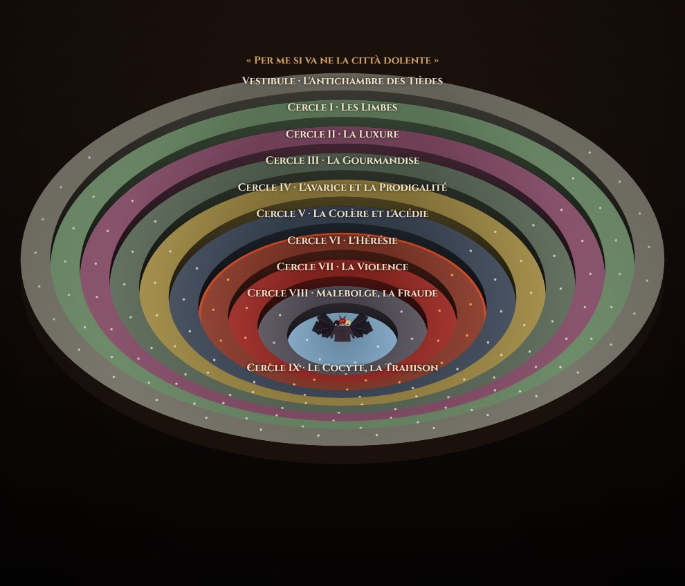
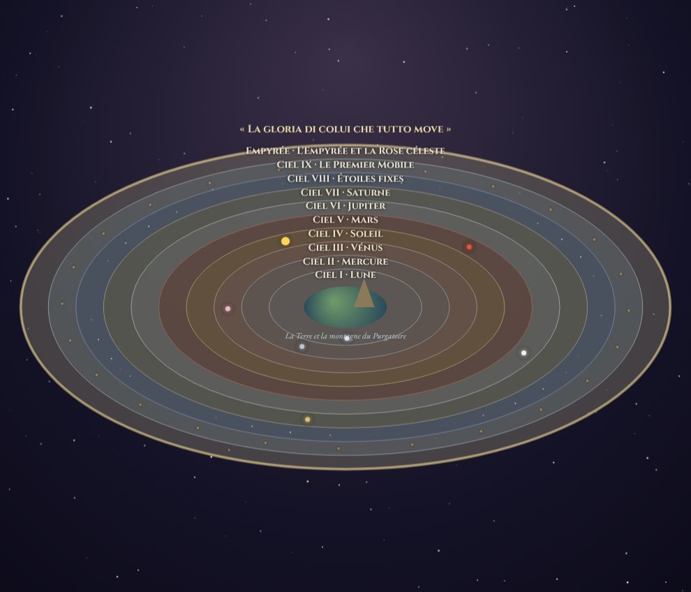

# L'Enfer et le Paradis de Dante — simulation 2.5D

Simulation jouable dans le navigateur des neuf cercles de l'*Inferno* et des dix cieux du *Paradiso* de Dante, en rendu isométrique 2.5D, avec deux dossiers PDF détaillés.
Les boutons **Enfer / Paradis** en haut de la page passent d'un royaume à l'autre (lien direct : `index.html#paradis`).



## Jouer

Ouvrez `index.html` dans un navigateur (aucune installation, aucun serveur nécessaire).

- **Vue d'ensemble** : l'entonnoir de l'Enfer ; cliquez sur un anneau ou appuyez sur Entrée pour descendre.
- **Dans un cercle** : déplacez Dante avec les flèches, ZQSD/WASD ou un clic sur le sol ; Virgile vous suit.
  Approchez une âme ou un gardien pour la rencontrer (compteur « Âmes rencontrées » en haut à gauche) ; survolez-les pour lire leur histoire.
- Entrée / N : cercle suivant · P : précédent · 0 à 9 : aller à un cercle · Échap : vue d'ensemble · molette : zoom · glisser : déplacer la vue.

Chaque cercle représente son lieu, ses âmes, leur châtiment (contrapasso) et son gardien : Charon, Minos, Cerbère, Plutus, Phlégyas, les Furies, le Minotaure et les Centaures, Géryon et les Malebranche, les Géants et Lucifer.

Au Paradis, Dante est guidé par Béatrice puis saint Bernard. Chaque ciel montre comment les âmes s'y manifestent : reflets pâles de la Lune, rondes de Vénus, couronnes de sages du Soleil, croix de Mars, aigle de Jupiter, échelle d'or de Saturne, triomphe des Étoiles fixes, neuf cercles d'anges du Premier Mobile et Rose céleste de l'Empyrée.



## Les dossiers PDF

- [`docs/Enfer_de_Dante.pdf`](docs/Enfer_de_Dante.pdf) (27 pages) : Dante et la Divine Comédie, géographie et ordre moral de l'Enfer, contrapasso, chaque cercle illustré et détaillé, gardiens, sortie, postérité, sources.
- [`docs/Paradis_de_Dante.pdf`](docs/Paradis_de_Dante.pdf) (27 pages) : l'ascension, le cosmos de Ptolémée et les chœurs des anges, les degrés de béatitude, chaque ciel illustré et détaillé, la vision de Dieu, l'Enfer et le Paradis en miroir, sources.

Pour les régénérer (après modification des données `js/*data.js` ou des captures dans `docs/images/`) :

```
pip install reportlab
python3 pdf/generer_pdf.py
python3 pdf/generer_pdf_paradis.py
```

## Structure

| Fichier | Rôle |
|---|---|
| `js/data.js` | Textes des cercles (partagés avec le PDF) |
| `js/iso.js` | Moteur isométrique : cases, particules, personnages, déplacement du joueur |
| `js/scenes.js` | Les dix scènes (vestibule + neuf cercles) et leurs créatures |
| `js/paradis-data.js` | Textes des cieux du Paradis (partagés avec le PDF) |
| `js/paradis-scenes.js` | Les dix scènes du Paradis et la vue des sphères célestes |
| `js/main.js` | Interface : choix Enfer / Paradis, vues d'ensemble, navigation, panneau, rencontres |
